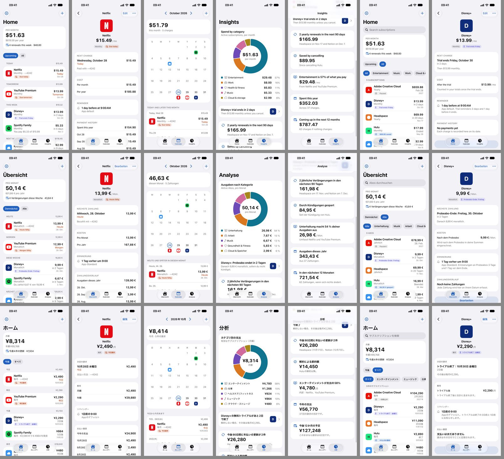
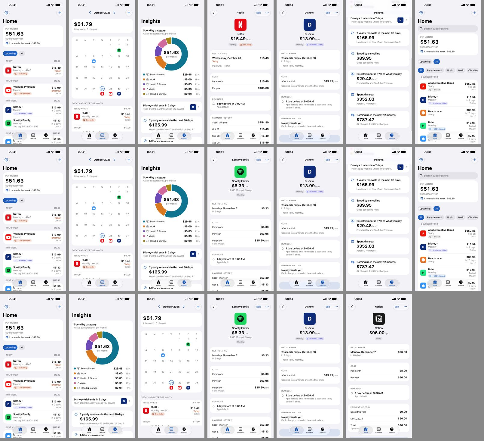

<h1 align="center">Shotwright</h1>

<p align="center"><strong>App Store screenshots, shot by an agent.</strong></p>

<p align="center">
Shotwright opens your app in the iOS Simulator, explores every screen on its own,<br>
and hands back App Store screenshots and videos for every device and every language.
</p>

<p align="center">
  <a href="https://shotwright-waitlist.vercel.app/"><strong>Join the waitlist →</strong></a>
  &nbsp;·&nbsp;
  <a href="PLAN.md">Build plan</a>
  &nbsp;·&nbsp;
  <a href="docs/spikes/">Engineering notes</a>
</p>

<p align="center">
  <a href="https://shotwright-waitlist.vercel.app/"></a>
  <a href="https://cerebralvalley.ai/e/meta-ai-developer-hackathon"></a>
  <a href="LICENSE"></a>
</p>

<p align="center">
  
  <br>
  <sub>A subscription tracker explored once by Muse Spark 1.3, then replayed in English, German and Japanese. Every pixel is a real Simulator capture; the model only chose the screens.</sub>
</p>

## The problem

Every release, an iOS developer needs up to 10 screenshots per device set — iPhone, iPad, and from April 2027 both displays of the iPhone Duo — for each of ~40 App Store locales, plus app previews and the new product page header and search assets. That is thousands of images, made by hand, for every version.

## How it works

1. **Connect.** A small agent runs on your Mac and builds your Xcode project for the Simulator. Your source code never leaves your machine.
2. **Explore.** A Muse model navigates the app from a screenshot and the accessibility tree, picks the most marketable screens and explains its picks.
3. **Record and replay.** The path to each screen is stored as accessibility identifiers, then replayed for every device and locale with a clean 9:41 status bar. Replays cost nothing.
4. **Compose.** Captions written for each market, device frames, backgrounds; preview, header and search videos cut from real screen recordings.
5. **Validate and upload.** Pixel sizes, alpha, video specs and App Store guidelines are checked before anything is uploaded.

The app's pixels are always real captures. AI writes the copy, ranks the screens and paints the backgrounds — never the app UI.

## Meta models

| Model | Role |
|---|---|
| Muse Spark 1.3 | Default explorer: screen ranking, captions, step repair, guideline checks (~$0.05 per app run) |
| Muse Wonder | Fallback explorer for apps where Spark gets stuck (fewer turns, higher cost) |
| Muse Spark Open (Baseten) | Screen judge, captions and bulk transcreation into ~40 locales |
| Muse Image | Backgrounds and header scenes, never app UI |
| SAM 3.1 | Tracking tapped elements in recordings for zooms and highlights, PII blurring |
| Muse Voice Transcribe | Describe your app by voice; the transcript seeds the marketing copy |

## What works today

- Pair a Mac from the site with a 6-character code; watch the Simulator live in the browser, click to tap.
- Our own XCUITest runner drives the Simulator over HTTP: no WebDriverAgent, no idb.
- Exploration on a real app: Spark 1.3, Wonder and Spark Open each found the same core screens; the recorded flow replayed 7/7 screens in en, de and ja.
- iPhone Duo captures at Apple's exact sizes on both displays (the inner display needs one manual unfold per boot).

<p align="center">
  
  <br>
  <sub>The same app explored by Spark 1.3 (top), Wonder (middle) and Spark Open (bottom), with only the hint "a subscription tracker".</sub>
</p>

Next up: step repair for localized labels, exploration from the site, composition and export, videos, App Store Connect upload. See [PLAN.md](PLAN.md).

## Run it

Requirements: macOS with Xcode 27.1, Node 24, ffmpeg, a [Meta Model API](https://dev.meta.ai) key.

```sh
npm install
cp .env.example .env.local        # add MUSE_API_KEY (and BASETEN_API_KEY, optional)
npm run dev                        # site + WebSocket server on http://localhost:3000
npm run agent -- connect           # on the Mac with Xcode; prints the pairing code
```

Enter the code on the site, pick a simulator, press **Live view**. Exploration and replay from the command line are documented in [docs/spikes/explorer.md](docs/spikes/explorer.md).

```
apps/web            Next.js site and WebSocket server (pairing, live view, remote driver)
packages/agent      Mac agent CLI: simctl, xcodebuild, runner, streaming
packages/explorer   Exploration loop, flow recorder, replay, screen judge
packages/muse       Dependency-free client for the Meta Model API
packages/core       Shared types: asset specs, flow schema, driver interface, protocol
ios/ShotwrightRunner  XCUITest-based HTTP driver for the Simulator
docs/spikes         What we measured and decided, with exact commands
```

## Hackathon

Built during the [Meta Global AI Developer Hackathon](https://cerebralvalley.ai/e/meta-ai-developer-hackathon) (Oct 26 – Nov 4, 2026), Indie track, theme *Build for Your World*. Everything in this repository was written during the event; the commit history is the record. The iOS apps shown are the author's own pre-existing apps, used only as input.

## License

[AGPL-3.0](LICENSE). If you run a modified version of Shotwright as a network service, you must make your source available to its users.
